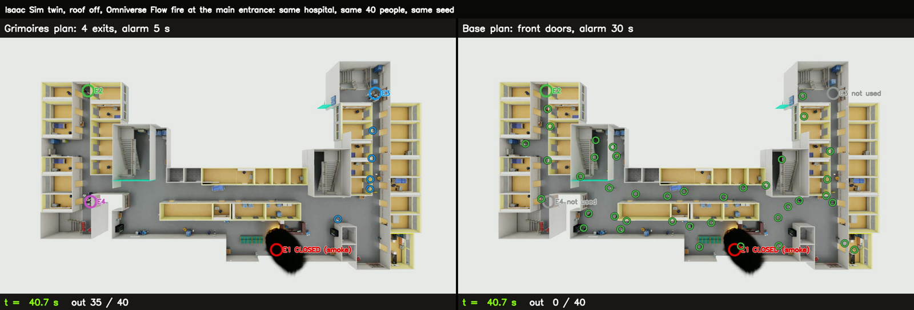
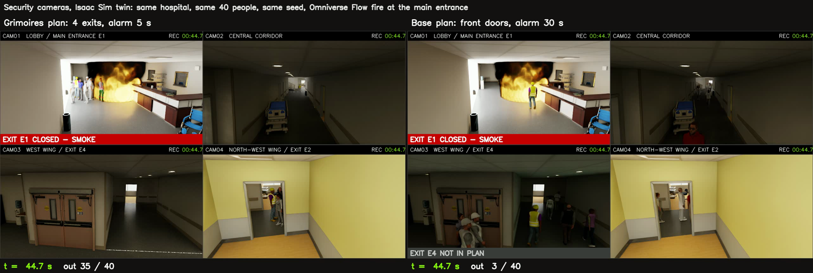
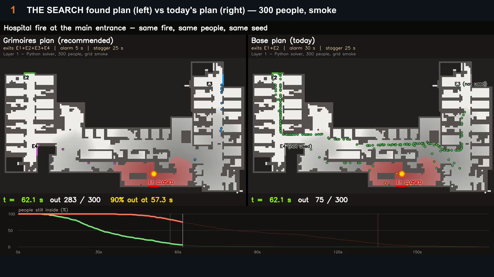
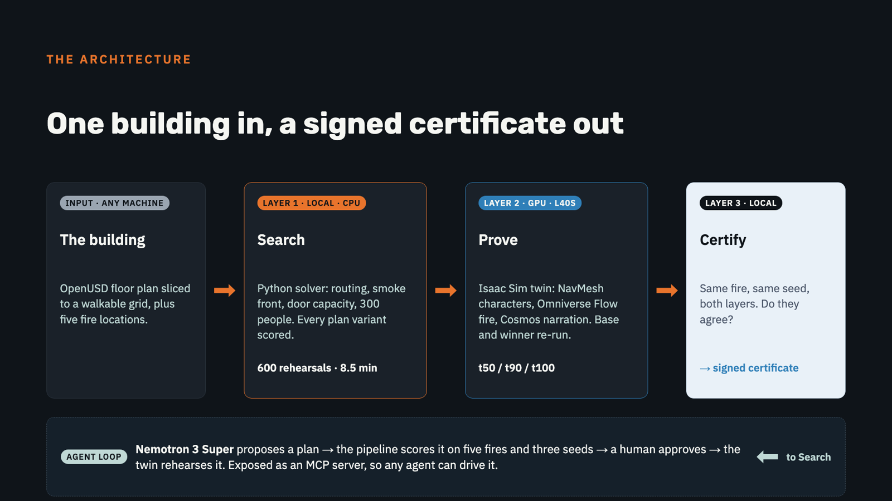

# Grimoires — the Evacuation Plan Certificate

Give Grimoires a building and its evacuation plan. It rehearses a fire, scores the plan with
hard numbers, **searches many plan variants and ranks them**, then **proves the winner in a
physical twin** — NVIDIA Isaac Sim characters path-finding through the real building — and
hands back a certificate: *where the plan fails, the fix, and before → after on the same fire.*

Venue: NVIDIA's Isaac **Hospital** environment (ground floor, 4 exits). Every number below
comes from files in `results/` and is reproduced by the commands in this README.

**Start here (5 minutes):** `renders/grimoires_demo.mp4` (53-second captioned reel) →
`docs/results/certificate.md` (the certificate, both layers) → `docs/results/agent_session.md`
(the Nemotron session, with its twin check) → `docs/PLAN.md` (every phase, outcome and decision).

## See it

The 53-second reel: the search (top-down, 300 people), the Isaac twin with the Omniverse Flow fire,
and the security-camera wall — each section labelled on screen.




*Isaac Sim twin, roof off, real Omniverse Flow fire at the main entrance. At 40.7 s the Grimoires plan has 35 of 40 out; today's plan has none. Every ring is a recorded character position.*



*The same run as a security-camera wall (`renders/hospital_cctv.mp4`): at 44.7 s, 35 of 40 out vs 3 of 40.*




*Layer 1, top-down: 300 people, the smoke front closing the entrance at 21.7 s, and the live race of the two clearance curves (`renders/hospital_map_layer1.mp4`).*

## The result so far (hospital, fire 4 m inside the main entrance, seed 42)

| | base plan `E1+E2, alarm 30 s` | recommended `E1–E4, alarm 5 s` |
|---|---|---|
| **Layer 1** — Python solver, 300 people: t90 | **135.9 s** | **57.3 s** (−58 %) |
| people over the 30 s smoke threshold | 54 | 6 (−89 %) |
| main entrance closed by smoke at | 21.7 s | 21.7 s |
| **Layer 2** — Isaac Sim twin, 40 characters (doors open): t90 | **62.6 s** | **30.0 s** — 40/40 out in both |
| Layer 2 with Omniverse Flow fire, entrance closed at 21.7 s: t90 | 120.2 s (38/40 out) | 45.1 s (40/40 out) |
| door-crowding flag, worst door (demand, Layer 1) | 1.3 p/m² (8 people) | 2.4 p/m² (15 people) — both green |
| Nemotron's pick `E1–E4, alarm 15 s, stagger 10 s`, same twin setup with fire: t90 | — | 43.0 s (40/40 out); most robust across five fires |

The base plan sends everyone to the front doors; the fire kills the main entrance at 22 s and
277 of 300 people queue through one door. Opening the two wing exits and alarming earlier
clears 90 % in under a minute. Across **five fire origins × 24 plans** the base plan ranks
**last under every fire** (`docs/results/robustness_table.md`).

The twin agrees on the ordering with doors open (headline, as Layer 1 assumes), with the
asset's door leaves closed (base 68.3 s vs winner 31.0 s) and with real Flow fire closing the
entrance (120.2 s vs 45.1 s) — see `docs/results/certificate.md`. The door-crowding flag
(`sim/crowding.py`: people not yet out within 2 m of a door, same definition in both layers,
red at 4 p/m²) stays green for both plans and goes red for the "everyone at once" plan
(5.1 p/m², 32 people on one door) — it is *demand* at the door, a crush-risk flag, not a crush model.

Videos (in `renders/`): `hospital_map_layer1.mp4` (top-down, 300 people, smoke),
`hospital_map_layer2_twin.mp4` (top-down, the twin's 40 characters), `hospital_dollhouse_overlay.mp4`
(real Isaac render, roof off, rings on every character from the recorded positions),
`hospital_dollhouse_fire.mp4` (same, with the Flow fire burning at the entrance),
`hospital_cctv.mp4` (four security cameras inside the building, both plans side by side, 2× speed).

Honest framing, kept exact: *rehearses / finds / ranks* — never *predicts*; *exit saturated / door crowding (demand)*
— never *crush*; the only density-shaped number is the door-crowding flag, labelled as risk, never prediction; simplified grid smoke model; the twin has
no door queuing (so it clears faster — stated next to every Layer-2 number); proxy venue;
*most robust plan among those tried*, not optimal.

## How it works



Only the twin needs a GPU; the search and the certificate run on a laptop. In text:

```
venue USD ─► sim/mall_plan.py ──► 0.5 m walkable grid + named exits (results/hospital/hospital_plan.json)
plan knobs: exits_open, alarm_delay_s, stagger_s                 (scenarios/*.json)

LAYER 1  sim/solve.py → sim/rehearse.py per variant: Dijkstra routing, smoke front,
         SFPE door cap, exposure → ranked variants, base vs winner        (seconds, CPU)

LAYER 2  sim/make_ira_config.py: plan → Isaac stage (exit targets + NavMesh spawn zones,
         nearest exit by walking distance) + one behaviour tree per exit
         (Wait alarm+stagger → MoveTo exit) + Isaac Replicator Agent config
         sim/ira/actor_sdg_dump.py runs it and records every character's position per frame
         sim/measure.py → t50/t90/t100, exits used, in the twin               (GPU, minutes)

LAYER 3  sim/certificate.py → docs/results/certificate.md: both layers, same fire, agree?
```

NVIDIA pieces: OpenUSD · Isaac Sim 6.0.1 · Isaac Replicator Agent (NavMesh, behaviour trees,
Replicator writers) · Isaac People characters · Hospital environment · Omniverse Flow (fire and
smoke) · Cosmos Reason 2 NIM (narration, self-hosted on the second L40S) · Nemotron 3 Super via
build.nvidia.com driving the pipeline through an MCP server (`sim/agent/`). Compute: NVIDIA
LaunchPad, 2 × L40S.

## Run it

**Layer 1 — any machine with Python 3 + numpy, no GPU** (the slicer needs `pxr`; see below):

```bash
python3 sim/rehearse.py --venue results/hospital/hospital_plan.json --plan scenarios/hospital_base_plan.json \
    --fire scenarios/hospital_fire_entrance.json --seed 42 --fps 12 --people 300 --report /tmp/base.json
python3 sim/solve.py --venue results/hospital/hospital_plan.json --base scenarios/hospital_base_plan.json \
    --fires scenarios/hospital_fire_entrance.json --people 300 --fps 12 --tag hospital --results results/hospital/layer1   # 24 variants, ~20 s
python3 sim/solve.py ... --fires scenarios/hospital_fire_entrance.json,scenarios/hospital_fire_e2_north.json,scenarios/hospital_fire_e3_east.json,scenarios/hospital_fire_e4_west.json,scenarios/hospital_fire_central.json --tag hospital_robust
```

**Venue slicing and Layer 2 — Isaac Sim 6.0.1 container** (pxr + numpy come from the container;
`sim/usdpy.sh` runs plain USD scripts without booting Kit):

```bash
# hospital geometry: copy Isaac/Environments/Hospital/ from the Isaac assets root to assets/hospital/
bash sim/usdpy.sh sim/mall_plan.py --usd assets/hospital/hospital.usd --name hospital_ground_floor_v1 \
    --ignore door --seal-perimeter --doors "E1:-1.25,-2.75;E2:-40.5,33.25;E3:20.75,31.25;E4:-38.25,8.75" \
    --out results/hospital/hospital_plan.json --png results/hospital/hospital_plan.png
bash sim/usdpy.sh sim/make_ira_config.py --plan scenarios/hospital_winner_plan.json --venue results/hospital/hospital_plan.json \
    --layer1-report results/hospital/layer1/rehearse_hospital_winner.json --people 40 --measure-only
# then, with the container's python and GPU — note the NavMesh-cap patch bind-mount (sim/ira/patches/):
/isaac-sim/python.sh /workspace/sim/ira/actor_sdg_dump.py -c /workspace/sim/ira/hospital_winner_measure.yaml \
    --dump /workspace/results/ira_hospital_winner_measure/agent_positions.jsonl
# measure needs no GPU: the recorded positions of every run are in the repo (gzipped)
gunzip -kc results/twin_runs/ira_hospital_winner_measure/agent_positions.jsonl.gz > /tmp/winner.jsonl
python3 sim/measure.py --venue results/hospital/hospital_plan.json --plan scenarios/hospital_winner_plan.json \
    --positions /tmp/winner.jsonl --report /tmp/layer2_winner.json
# the certificate exactly as committed (docs/results/certificate.md):
python3 sim/certificate.py --layer1 results/hospital/layer1/solve_hospital.json \
    --layer2-base results/hospital/layer2/layer2_base_doorsopen.json --layer2-winner results/hospital/layer2/layer2_winner_doorsopen.json \
    --layer2-note "door leaves switched off (doors open), as Layer 1 assumes; 40 characters; same seed and spawn positions in all twin setups" \
    --sensitivity "door leaves closed (NVIDIA asset as shipped)::results/hospital/layer2/layer2_base.json::results/hospital/layer2/layer2_winner.json" \
    --sensitivity "Omniverse Flow fire at the origin, E1 closed by smoke at 21.7 s::results/hospital/layer2/layer2_base_fire.json::results/hospital/layer2/layer2_winner_fire.json" \
    --sensitivity "the same Flow-fire run repeated (same seed; film render with brighter flames)::results/hospital/layer2/layer2_base_fire2.json::results/hospital/layer2/layer2_winner_fire2.json" \
    --crowding-check results/hospital/layer1/rehearse_hospital_loophole_a0s0.json --out docs/results/certificate.md
```

Three things that were not obvious and are handled in code: NVIDIA environments mark walls
and props `instanceable` (the slicer traverses instance proxies); the hospital's closed door
meshes seal every ward (`--ignore door`) while its exterior doorways must not be unregistered
leaks (`--seal-perimeter`); and Isaac characters move in Fabric, not USD, so positions are
read from IRA's agent objects, never from USD transforms.

## Layout

```
docs/              PLAN.md (phases, outcomes, decisions) · ARCHITECTURE.md · results/*.md (certificate, tables, agent sessions)
sim/               all code; sim/agent/ = MCP server + Nemotron loop; sim/ira/ = Isaac configs + NavMesh patch; sim/bt/ = trees
scenarios/         plans and fire origins (JSON)
results/hospital/  the curated numbers: walkable map, Layer-1 reports (layer1/), Layer-2 reports (layer2/), agent sessions (agent/)
results/twin_runs/ every Isaac run: positions (gzipped), metadata, sampled frames   — see "Evidence" below
results/box_*/     the GPU box's results folder and run logs, as they were
renders/           all films, including the 53-second reel
assets/            venue USDs and generated stages; the 1 GB hospital textures/props are fetched, not committed
```

The mall venue from the first iteration (`assets/venue_mall.usdc`, `scenarios/mall_*.json`,
`results/mall_*`) still works with the same commands; the hospital is the primary venue.

## Evidence pulled from the GPU box (LaunchPad was decommissioned after the event)

| Path | What it is |
|---|---|
| `renders/*.mp4` | every stitched film, plus `grimoires_demo.mp4` (the 53-second captioned reel) |
| `results/twin_runs/<run>/agent_positions.jsonl.gz` | every character's world position every frame, for 18 Isaac runs (one early probe wrote none) — the raw input to `sim/measure.py` (`gunzip` first) |
| `results/twin_runs/<run>/frames/<camera>/` | every 400th rendered RGB frame of every camera, as visual evidence of each run |
| `results/twin_runs/<run>/metadata.txt` | the IRA run metadata as written on the box |
| `results/box_results/` | the box's `results/` folder as it was: rehearsal reports, solver outputs, venue grids, Layer-2 reports |
| `results/box_home/` | the run queue status files, every Isaac run log (gzipped), the progress script and the NavMesh-cap patch exactly as bind-mounted |
| `sim/ira/*.yaml`, `sim/bt/*.json`, `assets/hospital/hospital_evac_*.usda` | every generated IRA config, behaviour tree and stage, including the CCTV, fire and agent-plan runs |

The hospital environment itself (`assets/hospital/` textures, props, `hospital.usd`) is NVIDIA's and is not redistributed; fetch it from the Isaac assets root as described above.
