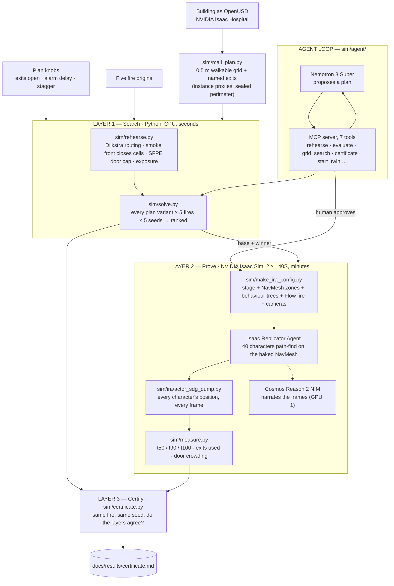
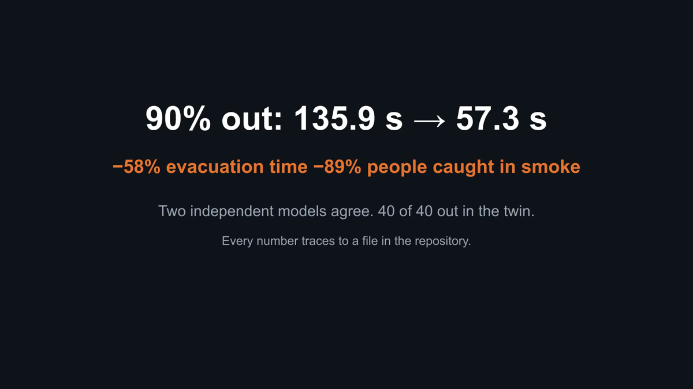

# Grimoires — the Evacuation Plan Certificate

**Team Grimoires · Presidio × NVIDIA Physical AI hackathon · October 2026**


*The NVIDIA Isaac Sim twin with the roof removed and a real Omniverse Flow fire at the main entrance. Left, the plan Grimoires found; right, today's plan. At 40.7 s: 35 of 40 out against 0 of 40. Every ring is a recorded character position; the red mark is the entrance the smoke has closed.*

> Every hospital, mall and venue has an evacuation plan, and it is signed off untested. Drills happen once a quarter
> per shift; a full-scale exercise is a half-day with outside fire crews; and no drill can put real smoke in a corridor
> at second 22. Grimoires rehearses the fire in simulation, searches hundreds of plan variants in minutes, proves the
> best one in a physical NVIDIA twin, and hands back a certificate: where today's plan fails, the fix, and
> before → after on the same fire.

## Watch the demo

**Demo reel — 53 s, labels itself: the search · the twin with fire · the security-camera wall**


**Security-camera wall — 60 s: four cameras per plan, both plans, same fire, 2× speed**


| More | |
|---|---|
| The certificate — both layers, same fire, the agreement verdict and every caveat | [docs/results/certificate.md](docs/results/certificate.md) |
| The Nemotron agent session, with its twin check | [docs/results/agent_session.md](docs/results/agent_session.md) · [unbounded first session](docs/results/agent_session_unbounded.md) |
| Robustness: 24 plans × 5 fires × 5 seeds | [docs/results/robustness_table.md](docs/results/robustness_table.md) · [one-fire ranking](docs/results/layer1_table.md) |
| Roof-off twin films | [`renders/hospital_dollhouse_fire.mp4`](renders/hospital_dollhouse_fire.mp4) (with fire, 116 s) · [`renders/hospital_dollhouse_overlay.mp4`](renders/hospital_dollhouse_overlay.mp4) (no fire, rings on every person) |
| Top-down explainer films | [`renders/hospital_map_layer1.mp4`](renders/hospital_map_layer1.mp4) (300 people, smoke) · [`renders/hospital_map_layer2_twin.mp4`](renders/hospital_map_layer2_twin.mp4) (the twin's 40) |
| Architecture in depth · build log, every phase and decision | [docs/ARCHITECTURE.md](docs/ARCHITECTURE.md) · [docs/PLAN.md](docs/PLAN.md) |

The pitch deck (13 slides) is a private claude.ai artifact; a PDF export is available on request.

## Architecture




The design decision that makes the numbers trustworthy is the **agreement test**: the fast solver and the physical
twin share nothing but the building and the plan knobs. Where they rank the plans the same way the certificate is
defensible; where they disagree, the planner missed something and the certificate says so.

## What it does, in one run

1. **Slice the building.** The hospital's OpenUSD scene becomes a 0.5 m walkable grid with four named exits.
   NVIDIA environments mark walls `instanceable`, so the slicer walks instance proxies; closed ward doors are ignored
   and the perimeter sealed so the only ways out are the real exits.
2. **Rehearse today's plan.** 300 people, a fire 4 m inside the main entrance, a smoke front that closes grid cells
   over time, an SFPE door-flow cap, smoke exposure per person. Today's plan (front doors only, alarm at 30 s) loses
   the entrance at **21.7 s**; 277 of 300 people funnel through one door; 90 % are out at **135.9 s**; 54 people exceed
   the 30 s smoke-exposure limit.
3. **Search the fix.** Every plan variant — which exits open, when the alarm sounds, how departures stagger — is
   rehearsed and ranked: 24 variants in 20 s on one fire, **600 rehearsals in 8.5 min** across five fire origins and
   five seeds. The winner opens all four exits and alarms at 5 s: 90 % out at **57.3 s** (−58 %), 6 people over the
   limit (−89 %). Today's plan ranks **last under every fire**.
4. **Prove it in the twin.** `make_ira_config.py` turns a plan into an Isaac Sim stage: exit targets, NavMesh spawn
   zones (nearest exit by walking distance), one behaviour tree per exit (*wait alarm + stagger → walk to the exit*),
   an Omniverse Flow fire at the same origin, cameras. Isaac Replicator Agent runs 40 characters; every position is
   recorded every frame and measured the same way as Layer 1.
5. **Certify.** Same fire, same seed, both layers in one table. They **agree**: winner faster in Layer 1 (57.3 vs
   135.9 s) and in the twin (30.0 vs 62.6 s doors open; 45.1 vs 120.2 s with the Flow fire closing the entrance).
   The twin clears about 2× faster at both plans because its characters do not queue at doors; that direction was
   predicted before the run and is printed next to every Layer-2 number.
6. **Let an agent drive it.** Nemotron 3 Super proposes plans through an MCP server, the pipeline scores them on five
   fires and three seeds, a human approves, the twin rehearses the pick. Its recommendation `E1–E4, alarm 15 s,
   stagger 10 s` is the most robust plan across the five fires and clears the twin in **43.0 s**, 40 of 40 out.

## The pipeline in pictures

### 1 · Layer 1 — today's plan against the found plan, top-down


*300 people, seed 42. The smoke front (red) closes the main entrance at 21.7 s; the live curves race to "everyone out".*


### 2 · Layer 2 — the Isaac Sim twin, roof off, real fire


*Same building, same 40 people, same seed, both plans. Rings are recorded positions, colour is the assigned exit;
the entrance turns red when smoke has closed it.*

### 3 · The security-camera wall


*Four fixed cameras authored in the stage (lobby, central corridor, the E4 corridor, the E2 corridor). A red banner
appears on any feed watching an exit once smoke has closed it. At 44.7 s: 35 of 40 out against 3 of 40.*

### 4 · The headline



## Results

**Hospital ground floor, fire 4 m inside the main entrance, seed 42** (`docs/results/certificate.md`):

| | today's plan `E1+E2, alarm 30 s` | found plan `E1–E4, alarm 5 s` |
|---|---|---|
| **Layer 1** — Python solver, 300 people: 90 % out | **135.9 s** | **57.3 s** (−58 %) |
| people over the 30 s smoke-exposure limit | 54 | 6 (−89 %) |
| main entrance closed by smoke at | 21.7 s | 21.7 s |
| **Layer 2** — Isaac Sim twin, 40 characters, doors open: 90 % out | **62.6 s** | **30.0 s** — 40/40 out in both |
| Layer 2, door leaves closed (asset as shipped) | 68.3 s | 31.0 s |
| Layer 2, Omniverse Flow fire, entrance closed at 21.7 s | 120.2 s (38/40 out) | 45.1 s (40/40 out) |
| door-crowding flag, worst door (demand, Layer 1) | 1.3 p/m² · green | 2.4 p/m² · green |
| **Agreement** | | **AGREE** on ordering in every twin setup |

**Robustness** (`docs/results/robustness_table.md`): 24 plans × 5 fire origins × 5 seeds. Today's plan ranks 24th of
24 under every fire. Most robust: `E1–E4, alarm 15 s, stagger 10 s` (worst-fire t90 58.0 s), which is also the plan
Nemotron recommended; the certified `E1–E4, alarm 5 s, stagger 25 s` is third.

**The agent** (`docs/results/agent_session.md`): three sessions. Unbounded, it chose alarm 0 s / stagger 0 s, which
scores well only because the simulator has no crowd collisions → plausibility floors. On one seed it "beat" the grid
by ten points and lost on three of five held-out seeds → every plan scored on three seeds, a pick must win on five
held-out ones. With guardrails on, it explored seven plans, found none better, and stopped on its own. Its pick ran in
the twin with the fire: 40 of 40 out, 90 % at 43.0 s.

**Door-crowding flag** (`sim/crowding.py`, identical in both layers: people not yet out within 2 m of a door, red at
4 p/m²): green for both real plans; **red at 5.1 p/m²** (32 people on one door) for the alarm-0 / stagger-0 loophole
plan — the data now catches what the floors were guarding against.

## NVIDIA technology, and what each piece actually does here

| Tool | Role | Status |
|---|---|---|
| OpenUSD · Isaac Sim 6.0.1 · Isaac Hospital environment | the building and the renderer of the twin | proven |
| Isaac Replicator Agent (NavMesh bake, behaviour trees, Isaac People) | the 40 evacuees: spawn zones, wait-then-walk trees, path-finding | proven (with a one-line NavMesh-cap patch, `sim/ira/patches/`) |
| IRA agent API (`AgentsManager`) | every character's world position every frame — characters move in Fabric, so USD transforms would read the spawn pose forever | proven |
| **Omniverse Flow** | the fire and smoke at the solver's fire origin, in the twin's own renders | proven (visual; the exit closure is scripted from Layer 1's time, not read back from Flow density) |
| Replicator writers, authored cameras via `sensor_prim_list` | overhead roof-off camera, four fixed security cameras | proven |
| **Cosmos Reason 2 8B** (NIM, self-hosted on GPU 1) | narrates frames of the twin; words only, never a source of numbers | proven |
| **Nemotron 3 Super 120B** (build.nvidia.com) | proposes plans against the pipeline through an MCP server; a human approves | proven |
| NVIDIA LaunchPad, 2 × L40S | GPU 0 renders Isaac, GPU 1 serves Cosmos, both busy at once | used throughout |
| Flow density read-back → NavMesh area cost | the twin closing exits from its own smoke | roadmap |

## Honesty notes

- It **rehearses, finds and ranks** plans; it never predicts a real fire. The recommendation is the *most robust plan
  among those tried*, never "optimal".
- **No crowd crush is modelled.** People do not collide in either layer. The only density-shaped number is
  *door-crowding demand*, labelled as a risk flag, never a crush prediction.
- The smoke is a simplified grid front model; Flow in the twin is the visual of the same fire. An FDS slice can
  replace the model behind the same interface.
- The twin has no door queuing, so it clears about 2× faster at both plans. Predicted, measured, printed.
- The twin's exit closure is scripted from Layer 1's closure time, so the "same exit unusable" half of the agreement
  test is **not independently testable yet** — the certificate says so rather than claiming it.
- Characters park on their exit target after arriving, and a character counts as out ~2.75 m before the door line.
  Six of 40 still reached the closed entrance because they had already set off (IRA does not re-route mid-walk).
- Proxy venue: NVIDIA's hospital, one floor, no stairs. Doors open is the headline setup, as Layer 1 assumes; doors
  closed is reported as a sensitivity.

## Repository layout

| Path | Contents |
|---|---|
| `sim/` | the whole pipeline: `mall_plan.py` (slicer), `rehearse.py` / `solve.py` / `plan.py` / `smoke.py` / `grid.py` (Layer 1), `make_ira_config.py`, `make_exit_targets.py`, `measure.py`, `crowding.py`, `certificate.py`, the film stitchers |
| `sim/ira/` | every Isaac Replicator Agent config that ran, the driver with the position dump (`actor_sdg_dump.py`), the GPU run queue, the NavMesh-cap patch |
| `sim/bt/` | the generated behaviour trees, one per exit per plan |
| `sim/agent/` | the MCP server (`grimoires_mcp.py`, 7 tools), the tool layer, the Nemotron loop with its guardrails |
| `scenarios/` | plans (base, winner, agent) and the five fire origins |
| `results/hospital/` | the curated numbers: walkable map, Layer-1 reports (`layer1/`), Layer-2 reports (`layer2/`), agent sessions (`agent/`) |
| `results/twin_runs/<run>/` | every Isaac run: `agent_positions.jsonl.gz` (every character, every frame), `metadata.txt`, `frames/<camera>/` (every 400th rendered frame) |
| `results/box_results/`, `results/box_home/` | the GPU box's results folder and its run logs, queue status files and progress script, as they were when LaunchPad was decommissioned |
| `assets/` | the generated Isaac stages (`hospital_evac_*.usda`) and the mall venue; the 1 GB hospital textures and props are NVIDIA's and are fetched, not committed |
| `renders/` | every film, including the 53-second reel |
| `docs/` | `ARCHITECTURE.md`, `PLAN.md`, `results/` (certificate, tables, agent sessions), `img/` |

Raw rendered frames (≈80 GB across the runs) are not in the repository; `renders/` holds the films and
`results/twin_runs/*/frames/` a sample of every camera.

## Reproduce

**Hardware:** Layer 1 and the certificate run on any laptop. The twin needs one GPU box; we used NVIDIA LaunchPad
with 2 × L40S (GPU 0 Isaac Sim, GPU 1 the Cosmos NIM).

**Software:** Python 3 + numpy for Layer 1. Isaac Sim container `nvcr.io/nvidia/isaac-sim:6.0.1` for the slicer
(`pxr`) and the twin; every IRA run bind-mounts `sim/ira/patches/simulation_util.py`, which lifts IRA's 100-frame
NavMesh-bake limit (`sim/ira/run_film_queue.sh` does this). Cosmos Reason 2 NIM `nvcr.io/nim/nvidia/cosmos-reason2-8b`.
Nemotron: an API key with build.nvidia.com access; `pip install "mcp<2"` for the server.

**Layer 1 — no GPU:**
```bash
python3 sim/rehearse.py --venue results/hospital/hospital_plan.json --plan scenarios/hospital_base_plan.json \
    --fire scenarios/hospital_fire_entrance.json --seed 42 --fps 12 --people 300 --report /tmp/base.json
python3 sim/solve.py --venue results/hospital/hospital_plan.json --base scenarios/hospital_base_plan.json \
    --fires scenarios/hospital_fire_entrance.json --people 300 --fps 12 --tag hospital --results results/hospital/layer1   # 24 variants, ~20 s
```

**Layer 2 from the committed positions — no GPU:**
```bash
gunzip -kc results/twin_runs/ira_hospital_winner_measure/agent_positions.jsonl.gz > /tmp/winner.jsonl
python3 sim/measure.py --venue results/hospital/hospital_plan.json --plan scenarios/hospital_winner_plan.json \
    --positions /tmp/winner.jsonl --report /tmp/layer2_winner.json
```

**The certificate, exactly as committed:**
```bash
python3 sim/certificate.py --layer1 results/hospital/layer1/solve_hospital.json \
    --layer2-base results/hospital/layer2/layer2_base_doorsopen.json --layer2-winner results/hospital/layer2/layer2_winner_doorsopen.json \
    --layer2-note "door leaves switched off (doors open), as Layer 1 assumes; 40 characters; same seed and spawn positions in all twin setups" \
    --sensitivity "door leaves closed (NVIDIA asset as shipped)::results/hospital/layer2/layer2_base.json::results/hospital/layer2/layer2_winner.json" \
    --sensitivity "Omniverse Flow fire at the origin, E1 closed by smoke at 21.7 s::results/hospital/layer2/layer2_base_fire.json::results/hospital/layer2/layer2_winner_fire.json" \
    --sensitivity "the same Flow-fire run repeated (same seed; film render with brighter flames)::results/hospital/layer2/layer2_base_fire2.json::results/hospital/layer2/layer2_winner_fire2.json" \
    --crowding-check results/hospital/layer1/rehearse_hospital_loophole_a0s0.json --out docs/results/certificate.md
```

**A twin run — Isaac Sim container with a GPU:**
```bash
# hospital geometry: copy Isaac/Environments/Hospital/ from the Isaac assets root to assets/hospital/
bash sim/usdpy.sh sim/mall_plan.py --usd assets/hospital/hospital.usd --name hospital_ground_floor_v1 \
    --ignore door --seal-perimeter --doors "E1:-1.25,-2.75;E2:-40.5,33.25;E3:20.75,31.25;E4:-38.25,8.75" \
    --out results/hospital/hospital_plan.json --png results/hospital/hospital_plan.png
bash sim/usdpy.sh sim/make_ira_config.py --plan scenarios/hospital_winner_plan.json --venue results/hospital/hospital_plan.json \
    --layer1-report results/hospital/layer1/rehearse_hospital_winner.json --people 40 --measure-only      # add --dollhouse --flow --smoke-closure for the film runs, --cctv for the camera wall
bash sim/ira/run_film_queue.sh winner_measure                                                              # runs actor_sdg_dump.py with the patch bind-mounted
```

**The agent:** `python3 sim/agent/nemotron_loop.py --rounds 8`, then `--approve <session.json>` to record the human
sign-off (`--twin` sends the approved plan to the GPU box).
